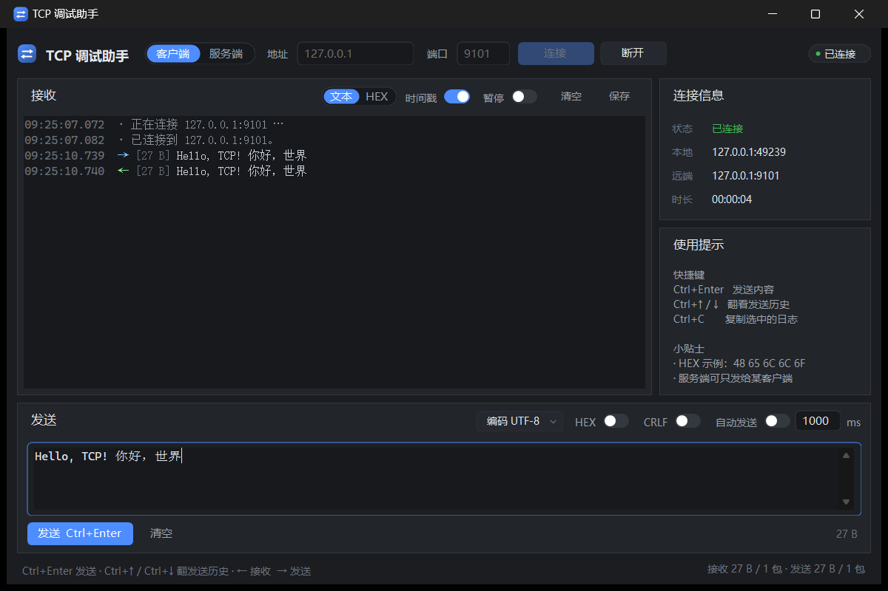
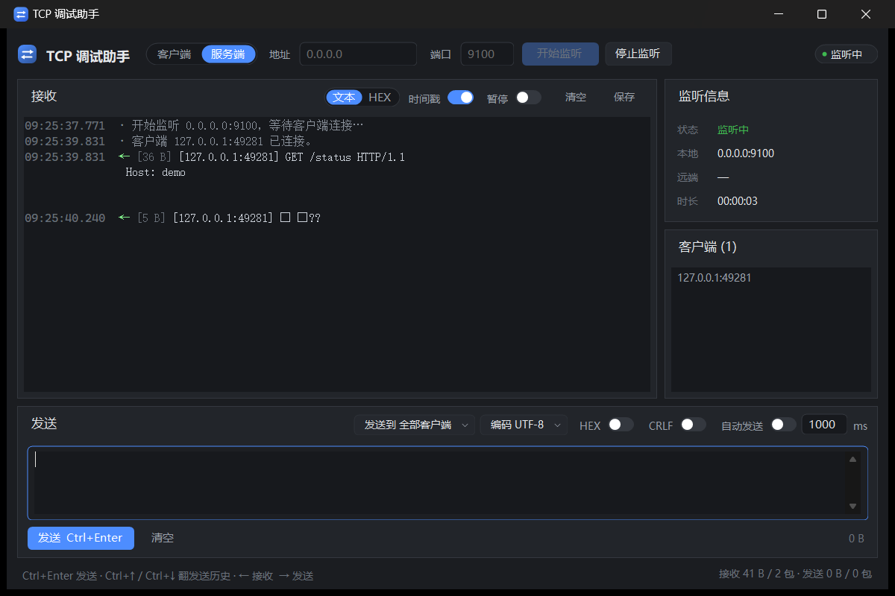

# TCP 调试助手

一个用 C# 写的 TCP 调试工具：**单文件、免安装**，双击即用。客户端/服务端双模式，支持文本与 HEX 收发、自动发送、日志保存。



## 功能

- **双模式**：作为客户端连接远端端口；或作为服务端监听端口，同时接受多个客户端。
- **文本 / HEX**：收发都支持 HEX，输入写法很宽松（`48 65 6C`、`0x48,0x65`、`48656C`、`48-65` 都行）。
- **多种编码**：UTF-8、GBK、GB18030、ASCII、Latin-1、UTF-16LE。
- **清晰的方向标记**：每行带时间戳、方向箭头和字节数；接收绿色、发送蓝色、错误红色。
- **自动发送**：可设间隔（最小 50ms）。
- **发送历史**：`Ctrl+↑ / Ctrl+↓` 翻看最近 100 条发送内容。
- **服务端定向发送**：发给「全部客户端」或列表里指定的某一个。
- **不丢数据**：暂停只停显示，接收与计数照常进行。
- **统计与保存**：实时收发字节/包数、连接时长；日志可一键清空或另存为文本。
- **记得住**：窗口大小、模式、地址端口、编码、各个开关都会自动保存。



## 快速开始

双击 `dist\TcpDebugAssistant.exe` 即可，不需要安装 .NET 运行时（使用 Windows 自带的 .NET Framework 4.8）。

**当客户端用**

1. 模式选「客户端」，填入目标地址和端口。
2. 点「连接」，状态变成绿色的「已连接」。
3. 在下方输入框输入内容，点「发送」或按 `Ctrl+Enter`。
4. 收到的数据会带绿色 `←` 出现在上方日志里。

**当服务端用**

1. 模式选「服务端」，监听地址一般填 `0.0.0.0`（所有网卡）或 `127.0.0.1`（只本机）。
2. 填端口，点「开始监听」。
3. 客户端接入后会出现在右侧「客户端」列表里。
4. 发送时可选择发给全部客户端或某一个。

**HEX 收发**

- 发送：打开发送区的「HEX」开关，输入 `48 65 6C 6C 6F`，点发送。
- 接收：点接收区的「HEX」，之后的包会以十六进制 + 右侧 ASCII 预览显示。

## 快捷键

| 快捷键 | 作用 |
| --- | --- |
| `Ctrl+Enter` | 发送当前输入内容 |
| `Ctrl+↑` / `Ctrl+↓` | 翻看发送历史 |
| `Ctrl+C` | 复制日志中选中的内容 |
| `Ctrl+A` | 全选日志 |

## 命令行参数

想从快捷方式或脚本直接进入某个状态时可用：

```
TcpDebugAssistant.exe --server --port 9100                 # 启动后自动开始监听
TcpDebugAssistant.exe --host 192.168.1.10 --port 5000 --connect   # 启动后自动连接
```

| 参数 | 说明 |
| --- | --- |
| `--server` / `--client` | 指定启动时的模式 |
| `--host <地址>` | 目标地址或监听地址 |
| `--port <端口>` | 端口 |
| `--connect` | 启动后自动连接 / 开始监听 |

## 构建

不需要安装 .NET SDK，直接用 Windows 自带的 C# 编译器（.NET Framework 4.8）：

```bat
build.cmd                :: 生成 dist\TcpDebugAssistant.exe
build.cmd -Test          :: 编译并运行测试
build.cmd -Run           :: 编译并启动
```

如果 PowerShell 提示脚本被禁止运行，用 `build.cmd` 即可（它已经带了 `-ExecutionPolicy Bypass`）。

`tools\make-icon.ps1` 用于重新生成 `src\App\app.ico`；`tools\capture-window.ps1` 和 `tools\UiProbe` 是开发期截图/渲染用的小工具，不参与正式构建。

## 项目结构

```
src\Core\          与界面无关的核心逻辑（HEX 编解码、编码、十六进制视图、发送历史、统计、Socket 封装）
src\App\           WinForms 界面（主题、自绘控件、主窗口、设置持久化）
tests\             38 个测试用例（自带极简测试运行器，不依赖 NuGet）
tools\             开发辅助脚本与界面探针
dist\              构建产物
```

## 测试

```bat
build.cmd -Test
```

当前 38 个用例，覆盖：

- HEX 文本解析的合法/非法输入、异常信息定位
- 编码解析与不可用编码的降级
- 十六进制视图的补位对齐、不可打印字符处理
- 发送历史的光标语义、去重、容量淘汰
- 收发统计与字节数格式化
- 基于本机回环的真实 socket 测试：客户端/服务端互相收发、会话列表、连接断开通知、连接被拒绝

## 说明与限制

- 日志最多保留约 40 万字符，超出后自动丢弃最旧部分，避免长时间高流量下界面卡顿。
- HEX 视图对切换之后收到的数据生效，不会重绘历史记录。
- 自动发送最小间隔 50ms。
- 运行环境：Windows 10 / 11（自带 .NET Framework 4.8）。
